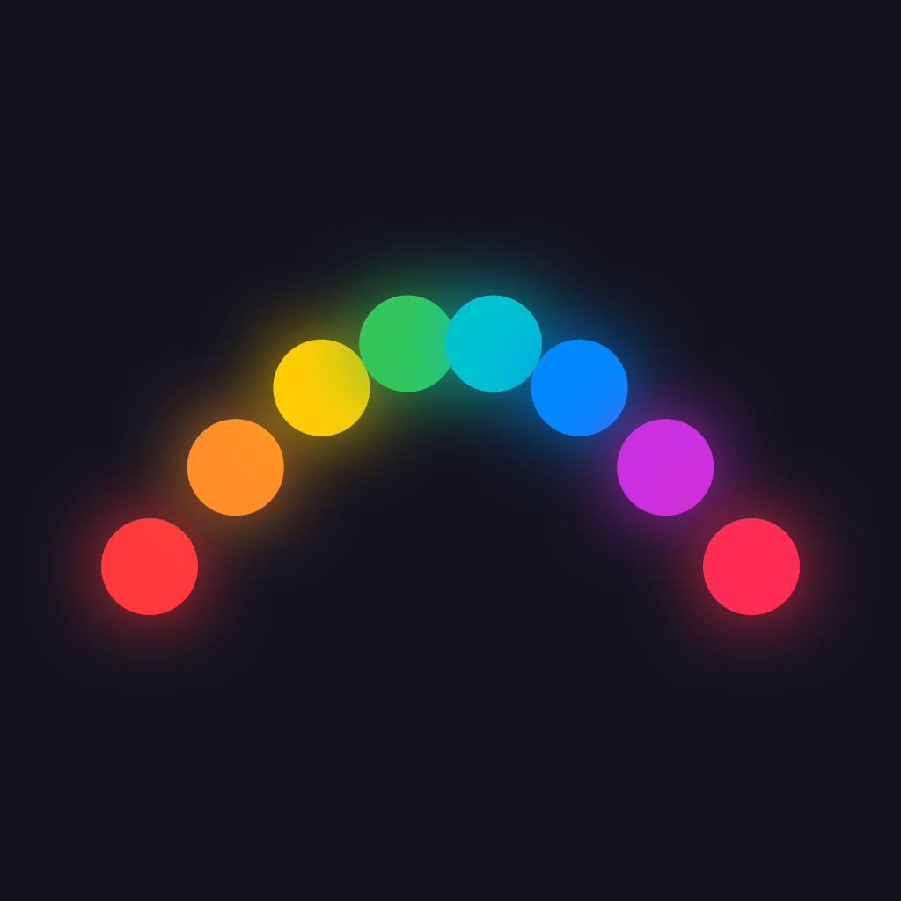

<p align="center"></p>

# CarLED

A native iOS app for controlling the Bluetooth LED strips in my car (a cheap **ELK-BLEDDM** controller), with **Siri** voice control that works hands-free through **CarPlay**, and a CarPlay screen ready for when Apple approves it.

I built it because the app that came with the strip locks its fade and strobe effects behind adverts, and its Siri shortcut didn't work in CarPlay. The whole thing was built in one session with [Claude Code](https://claude.com/claude-code), from my prompts (included below).

On the phone the app is called **Car Light**, so Siri commands read naturally: *"Hey Siri, set Car Light to purple."*

## Features

- **Full remote:** power, brightness, a colour wheel with 10 quick colours, and a warm-to-cool white slider
- **22 built-in effects** with a speed control, and nothing locked:
  - **Jumps:** RGB Jump, Rainbow Jump
  - **Fades:** RGB Fade, Rainbow Fade, 7 single-colour pulses, and 3 two-colour fades
  - **Strobes:** Rainbow Strobe and 7 single-colour strobes
- **Siri and Shortcuts** (App Intents), which work with the phone locked and through CarPlay:
  - "Turn on Car Light" / "Turn off Car Light"
  - "Set Car Light to blue" (red, orange, yellow, green, cyan, blue, purple, pink, white, warm white)
  - "Set Car Light to fade" / "Start Red Strobe on Car Light"
  - "Change Car Light brightness"
- **Auto-connect:** picks up the strip on first launch, then keeps a pending Bluetooth connection so it reconnects by itself whenever the car powers the strip
- **CarPlay app** with Lights and Effects tabs, built as a CarPlay "Driving Task" app
- **Activity log** in the app showing every Siri request, connection event and command sent, for debugging in the car

## How it works

ELK-BLEDOM / BLEDDM controllers take 9-byte commands written to the Bluetooth characteristic `FFF3`. Each command starts with `0x7E` and ends with `0xEF`:

| Command    | Bytes                              |
|------------|------------------------------------|
| Power on   | `7E 00 04 F0 00 01 FF 00 EF`       |
| Power off  | `7E 00 04 00 00 00 FF 00 EF`       |
| Colour     | `7E 00 05 03 RR GG BB 00 EF`       |
| Brightness | `7E 00 01 BB 00 00 00 00 EF` (0-100) |
| Effect     | `7E 00 03 MM 03 00 00 00 EF` (MM = 0x87-0x9C) |
| Speed      | `7E 00 02 SS 00 00 00 00 EF` (0-100) |

The effects run on the controller itself, so the phone only has to say which program to play.

```
CarGlow/
├── App/            SwiftUI app entry
├── Bluetooth/      ELKProtocol (command bytes) + LEDController (CoreBluetooth, state, auto-reconnect)
├── Model/          RGB, LightEffect, LightColour (also Siri parameter types)
├── Intents/        App Intents + App Shortcuts (Siri phrases)
├── CarPlay/        CPTemplateApplicationSceneDelegate (list templates)
└── Views/          Remote screen, colour wheel, effects grid, device picker
```

**Stack:** Swift 5, SwiftUI, Observation, CoreBluetooth, App Intents, CarPlay, and XcodeGen. Requires iOS 17 or later.

## Building

```bash
brew install xcodegen
xcodegen generate
open CarGlow.xcodeproj
```

Set your own team in `project.yml` (`DEVELOPMENT_TEAM`) and run the app on a real iPhone. The simulator has no Bluetooth.

The CarPlay entitlement (`com.apple.developer.carplay-driving-task`) is only applied to simulator builds, so you can try it in the CarPlay Simulator. Running it in a real car needs a paid developer account and Apple's approval. Siri voice control works through CarPlay without it.

## My prompts

These are the prompts I gave Claude Code during the build, lightly tidied:

1. > can u write xcode for ios?
2. > ok so i have an app on my iphone called lumo remote but its ad locked for some effects. What the app essentially is a controller for my LED strips in my car. They're just normal LED strip, and it connects over Bluetooth. So what I want is an app that, as you can see in the screenshot, has all the effects like fade and color fade and stuff like that. And the app should also be compatible with Siri shortcuts, because at the moment I have a Siri shortcut to turn the car light on as soon as like my car is connected to CarPlay. Theoretically as well, it'd be really nice if you can make a CarPlay app. So if I do want to change the color, I can ask Siri to do so as I'm driving. I don't know what iOS I have to be on to have a CarPlay app need to test. My iPhone is an iPhone 13 Pro, and it's currently on iOS 18.7.8. If you need any more info from me on this, let me know. Yeah, I have Xcode installed on my Mac and all. *(with two screenshots of the old app)*
3. > Thanks. I have a shortcut. I don't know if you can see my shortcuts on my actual laptop now, if you go to the shortcuts app, but can you help me make a car light shortcut? It's, yeah, if you go to my shortcuts on my laptop, you can see Polo light on and Polo light off. That's what's currently using the old one. So if you can just make it like car light on or something like that.
4. > So are you sure that this will work with Siri in CarPlay if I ask it to like change the color of the light? Because currently, like when I ask Siri polo light on, it doesn't work, even when I say it's a shortcut.
5. > did it, and it asked, do I want to allow Siri to like control cargo or something like that, and then I said yes, and then it said something went wrong. I don't know. Anyway, can I just like also have Siri just be able to like react if I say car light, not car glow, like if I say set car light to blue or purple or something, or fade.
6. > Yeah, so I did that, but it still said something went wrong. Is that just because I'm not connected to a LED strip at the moment? Because at the moment, like, the color wheel is grayed out as well on the app and brightness and stuff. I'm gonna test it later at the car, but just wanna make sure that you've got all the code and stuff ready.
7. > ok in effects what effects are there as its greyed out and i cant see them atm
8. > ok thanks. can we push this to github plz and add a readme of what we built and my prompts. for my portfolio maybe just name it CarLED on a new github project

### What Claude Code did along the way

- Found the strip's chipset from the screenshot ("ELK-BLEDDM 13") and used its publicly documented Bluetooth commands
- Set up the project with XcodeGen, built it, then signed and installed it on my iPhone from the terminal
- Generated the app icon with a small CoreGraphics script
- Read my existing Shortcuts from the Mac's Shortcuts database, then made and signed matching "Car Light On / Off / Evening" shortcuts that use the new app
- Renamed the app from "CarGlow" to "Car Light" so Siri phrases sound natural
- Found that Siri was swapping the app's error message for a generic "something went wrong", changed the actions so Siri always speaks a proper reply, and added an in-app activity log for testing in the car

## Status

- Built and installed on an iPhone 13 Pro (iOS 18)
- In-car testing with the real strip still to do
- CarPlay screen tested in the simulator only, pending Apple's entitlement

## Disclaimer

This is an independent personal project. It is not affiliated with the makers of Lumo Remote or ELK-BLEDOM / BLEDDM hardware.
